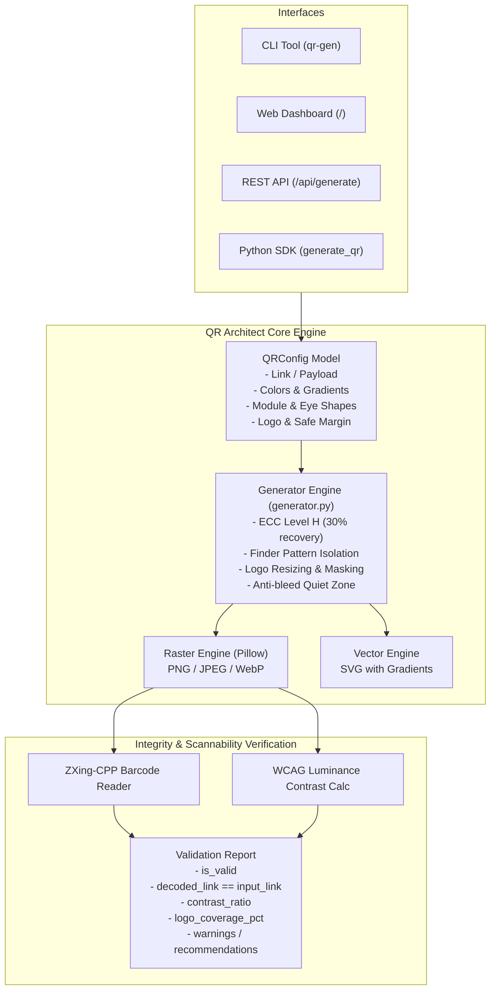

# QR Architect 🏛️

A production-grade architecture for generating custom-styled QR codes with custom colors, gradients, module geometry, and embedded center logos **while mathematically guaranteeing link retention and scannability**.

---

## 🌟 Key Capabilities

- **Mathematical Link Retention**:
  - Automatically enforces **Reed-Solomon Error Correction Level H (~30% recovery capacity)** or Level Q (~25%) when embedding logos.
  - Automatically clamps embedded logo scale to safe bounds ($\le 28\%$ of total QR dimension, default $22\%$) so data modules and finder patterns are never critically occluded.
  - Adds an automatic anti-bleed quiet margin around logos so camera binarization algorithms cleanly separate data dots from the logo artwork.
  - Integrated with **`zxing-cpp`** for automated decode & link retention verification upon every generation.

- **Full Palette & Gradient Customization**:
  - **Foreground modules**: Solid colors or gradients (Linear Horizontal, Linear Vertical, Linear Diagonal, Radial).
  - **Background**: Solid color or full **alpha transparency** for overlaying onto posters, flyers, or websites.
  - **Independent Eye Styling**: Custom colors and shapes for the 3 corner finder pattern outer frames and inner balls.
  - **Module Geometries**: Rounded, Circular Dots, Classic Squares, and Gapped Squares.

- **Dual-Mode Vector & High-Res Raster Export**:
  - **PNG / JPEG / WebP**: Crisp raster exports up to print resolution (1024px, 2048px, 4096px).
  - **SVG Vector**: Clean, infinite-resolution vector graphics with native SVG gradients and embedded images.

- **Multi-Interface Architecture**:
  - **Python SDK**: High-level typed API (`generate_qr`, `verify_qr_image`, `QRConfig`).
  - **CLI Tool (`qr-gen`)**: Command-line generator and verifier for terminal pipelines and bash scripts.
  - **REST API (FastAPI)**: High-performance endpoints with interactive Swagger UI (`/docs`).
  - **Web Dashboard**: Interactive real-time UI with live preview, color pickers, and instant scannability badge.

---

## 🏗️ Architecture Overview



---

## 🚀 Quick Start

### 1. Installation

The environment is already pre-configured with Python 3.11 and all dependencies. To install into any environment:

```bash
# Clone or navigate to the workspace
cd /home/alty/projects/qr-code

# Activate virtualenv or install via pip
source .venv/bin/activate
pip install -e .
```

### 2. Using the Executable CLI (`./qr_gen`)

#### Generate a styled QR code with custom colors:
```bash
./qr_gen generate \
  --data "https://antigravity.google.com" \
  --fg "#1e3a8a" \
  --bg "#ffffff" \
  --eye-outer "#1d4ed8" \
  --eye-inner "#0284c7" \
  --module-style rounded \
  --output my_code.png
```

#### Embed an image/logo with automatic link retention verification:
```bash
./qr_gen generate \
  --data "https://antigravity.google.com" \
  --preset modern_tech \
  --logo examples/sample_logo.png \
  --logo-shape circle \
  --logo-scale 0.22 \
  --output logo_qr.png
```

#### Generate a scalable SVG vector with a diagonal gradient:
```bash
./qr_gen generate \
  --data "https://antigravity.google.com" \
  --fg "#e11d48" \
  --gradient linear_diagonal \
  --gradient-end "#7c3aed" \
  --output gradient_qr.svg
```

#### Verify an existing QR code image:
```bash
./qr_gen verify logo_qr.png --expected "https://antigravity.google.com"
```

#### Start the Interactive Web Dashboard & API server:
```bash
./qr_gen serve --port 8000
```
Then visit **http://localhost:8000** in your browser.

---

## 🐍 Python SDK Usage

### Basic Customization & Verification

```python
from qr_architect import QRConfig, ColorConfig, ModuleStyle, EyeStyle, generate_qr

config = QRConfig(
    data="https://antigravity.google.com",
    colors=ColorConfig(
        front_color="#1e3a8a",
        back_color="#ffffff",
        eye_outer_color="#1d4ed8",
        eye_inner_color="#0284c7"
    ),
    module_style=ModuleStyle.ROUNDED,
    eye_style=EyeStyle.ROUNDED
)

result = generate_qr(config)

# Link retention report
print("Scannable?   :", result.validation.is_valid)
print("Decoded Link :", result.validation.decoded_text)
print("Contrast     :", result.validation.contrast_ratio)
```

### Embedding a Logo with Guaranteed Retention

```python
from qr_architect import (
    QRConfig,
    ColorConfig,
    LogoConfig,
    LogoShape,
    ErrorCorrection,
    generate_qr
)

config = QRConfig(
    data="https://antigravity.google.com/enterprise",
    colors=ColorConfig(
        front_color="#0f172a",
        back_color="#ffffff"
    ),
    error_correction=ErrorCorrection.H,  # 30% recovery capability
    logo=LogoConfig(
        image_path="examples/sample_logo.png",
        scale=0.22,               # Safe zone <= 28%
        shape=LogoShape.CIRCLE,   # Circle mask
        padding=4,                # 4px quiet zone around logo
        bg_color="#ffffff"
    )
)

result = generate_qr(config)
assert result.validation.matches_payload, "Decoded link must match input!"
```

---

## 🌐 REST API Endpoints

| Method | Endpoint | Description |
|---|---|---|
| `GET` | `/` | Interactive Web Dashboard |
| `GET` | `/docs` | Interactive Swagger / OpenAPI documentation |
| `GET` | `/api/health` | Service health status |
| `GET` | `/api/presets` | List all curated design presets |
| `POST` | `/api/generate` | Generate QR code (returns base64 data URI + validation report) |
| `POST` | `/api/generate/file` | Generate and return raw image binary directly (`image/png`, `image/svg+xml`) |
| `POST` | `/api/verify` | Upload image file to decode and verify link retention |

---

## 🎨 Curated Presets

You can use presets out of the box with `--preset <name>`:
- `modern_tech`: Slate blue body, indigo finder frame, cyan inner ball.
- `sunset_glow`: Diagonal sunset gradient from coral rose (`#e11d48`) to vibrant violet (`#7c3aed`).
- `emerald_pro`: Executive emerald green with forest frame and mint accents.
- `cyberpunk_neon`: Dark midnight slate background with glowing cyan and magenta accents.
- `royal_violet`: Linear horizontal gradient from indigo (`#6366f1`) to fuchsia (`#d946ef`).
- `corporate_navy`: Classic authoritative navy blue with rounded modules.
- `minimal_monochrome`: Pure black and white with high-contrast circular finder patterns.

---

## 🧪 Test Suite

Run the automated test suite with pytest:

```bash
.venv/bin/pytest -v
```

All 13 unit tests verify:
- End-to-end QR code generation and decoding
- Color and gradient interpolation
- Multi-style module rendering (square, circle, rounded, gapped)
- Multi-style finder eye rendering
- Logo embedding within Reed-Solomon Error Correction capacity
- SVG vector valid generation
- WCAG contrast analysis and low-contrast warnings
- REST API endpoint functionality
